# LoomNote

LoomNote is a desktop study workspace for turning course material into editable notes, interactive explanations, a persistent review queue and course knowledge-point maps. It is built for AILT9019 · AI Literacy II, HKU (Fall 2026).

Start by creating a course, import its materials, and ask the study agent to organise them. The original source stays beside the note. Knowledge points such as **AVL balance factor**, **right rotation**, **permutations** and **combinations** become map nodes with definitions, relationships and links back to the source. Select one course or several courses in the map.

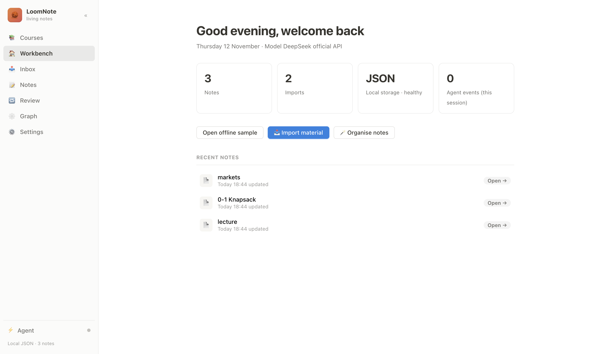

The repository contains the runnable application, source code, tests, cross-platform setup scripts and development documentation. Private course originals, local credentials, generated recordings and submission reports are intentionally kept out of Git.

## Feature overview

| Area | What the product does | Where to see it |
|---|---|---|
| Courses | Create, rename, archive and restore course folders; assign notes and upload several materials at once. | [Complete workflow](#try-the-complete-workflow) |
| Document ingestion | Extract text from PDF, DOCX, PPTX, XLSX, Markdown, TXT, CSV/TSV, HTML, JSON, TeX and logs; keep the original source beside the extracted text. | [Supported formats](#format-boundaries) |
| AI note generation | Stream a visible agent run that reads `source/extracted.md`, edits `note.md`, and keeps follow-up requests scoped to the current note. | [Complete workflow](#try-the-complete-workflow) |
| Source study | Read the generated note, inspect original PDF pages, and use a side-by-side source/note view with page-linked citations. | [Interface examples](#interface-examples) |
| Interactive explanations | Render `:::demo` blocks in an isolated iframe with CSP, static checks and runtime checks for visible drawing and controls. | [Demo documentation](docs/DEMO.md) |
| Merge workflow | Preview additions and updates from another lecture, choose changes, and retain both source files after applying. | [Workflow](docs/PIPELINE.md) |
| Review centre | Reveal self-test answers, rate recall, schedule the next due time, and keep review history through restart. | [Interface examples](#interface-examples) |
| Knowledge-point maps | Show concrete concepts with definitions, relationships, course filters and source-page provenance; nodes are knowledge points, not files. | [Interface examples](#interface-examples) |
| Preferences | Save explicit preferences such as `Remember: use inline formulas`, then edit or delete them in Settings. | [Interface examples](#interface-examples) |
| Platforms | Open the same app on macOS and Windows with automatic local setup and a JSON fallback when native SQLite is unavailable. | [Open the app](#open-the-app) |

## What works

- **Course library:** create, rename, archive and restore courses; upload multiple files into a course; move a note between courses; search/filter notes by course.
- **Common document formats:** PDF, DOCX, PPTX, XLSX, Markdown, TXT, CSV/TSV, HTML, JSON, TeX and log text. PNG/JPEG/WebP sources can be interpreted by a vision-capable model. See the boundaries below.
- **File-backed notes:** the agent reads and edits `note.md` using the DeepSeek Harness runtime (`@deepseek-ai/dsh@0.2.0-rc.2`), with visible tool calls and streamed responses. Follow-up requests can change a specific passage.
- **Original lecture view:** PDF pages, a side-by-side slide/note view, source selection for merged lectures, and source-page links from review cards and knowledge points.
- **Interactive explanations:** `:::demo` blocks run in isolated iframes with a restrictive CSP. The app checks HTML discipline and whether the demo draws content and exposes controls. The Next interaction is exercised in the live recording.
- **Reviewable merge:** preview additions and updates from another lecture, then apply selected changes. Existing sections are retained unless explicitly selected; stale proposals are refused. Both original sources remain available.
- **Review centre:** self-test questions become cards with individual answers and page citations. Reveal, self-rate Again/Hard/Good/Easy, and return later. History and due times survive a restart. This is a simple, documented interval scheduler, not FSRS or an automatic assessment of understanding.
- **Knowledge-point maps:** definitions and explicit relationships are extracted alongside generated notes. The same point across notes joins within its course; different courses remain distinct. Existing notes fall back to meaningful headings and bold definitions. Files and folder names are provenance, not map nodes.
- **Simple preferences:** explicitly ask “Remember: use inline formulas”, or edit/delete preferences in Settings. Preferences and self-rated review history inform later requests without another memory service.
- **Offline sample and bilingual interface:** open the clearly labelled bundled sample without a model key. English and Chinese interfaces are available.

## Open the app

Download and extract the [source ZIP](https://github.com/PUFFERFISHTNT/loomnote/archive/refs/heads/main.zip), or clone the repository. Keep the extracted folder writable.

| Platform | First run and later launches |
|---|---|
| **Windows** | Double-click **start.cmd**. |
| **macOS** | Double-click **start.command**. If Finder blocks a downloaded script, use **Open** from its context menu, or run `bash scripts/start.sh` in Terminal. |

The first launch prepares a plain **Node.js 24+** runtime if one is missing, installs **pnpm 10.34.5** locally, installs the frozen dependencies, downloads Electron, builds the app and opens it. Runtime downloads come from the official Node.js site and are checked against its SHA-256 manifest. Tools live in the ignored `.runtime/` folder; no global npm installation or administrator privileges are needed. Keep an internet connection for initial setup. Later launches reuse the build; source/dependency changes trigger setup again.

For setup without opening a window, double-click **setup.cmd** (Windows) or **setup.command** (macOS). On macOS/Linux the shell equivalents are `bash scripts/setup.sh` and `bash scripts/start.sh`. `LOOMNOTE_NODE` can select an existing plain Node.js 24+ binary. The agent runs under plain Node rather than Electron's embedded runtime. SQLite is used when its native binding loads; otherwise the supported local JSON store keeps the same app workflow without requiring a C++ compiler.

Once the window opens, choose **Open offline sample** to try notes, an interactive demo, review and concept maps without credentials. For new AI generation, open **Settings**, select a provider, enter your own API key, test the connection and save. DeepSeek official is the default preset; compatible endpoints can be added. The models-list check tests authentication and model availability; it does not guarantee a generation or vision request will succeed.

Optional local configuration belongs in the ignored `config/local.env`; [config/local.env.example](config/local.env.example) contains the supported fields. Credentials are loaded only for the application after dependency installation and build complete. No key is included in this repository.

If your network requires a proxy, configure `HTTPS_PROXY` / `HTTP_PROXY` before setup. Dependency and Electron downloads honour those variables; the launcher does not add a proxy to your model configuration. Retry the same launcher after a failed download.

### Developer setup

Install plain Node.js 24+ and pnpm 10.34.5, then:

```bash
pnpm install --frozen-lockfile
pnpm setup:electron
pnpm typecheck
pnpm test
pnpm build
pnpm dev
```

The lockfile pins the dependency tree and `packageManager` pins pnpm. The Windows and macOS CI matrix runs setup, portable Node bootstrap, launch smoke checks, offline tests and a real Electron workflow with restart. [View CI](https://github.com/PUFFERFISHTNT/loomnote/actions/workflows/ci.yml).

## Try the complete workflow

1. Open **Courses**, create `COMP2119`, and choose **Upload material**. In a public checkout, use the bundled offline sample or provide your own permitted PDF locally; the repository does not publish course PDFs. The original PDF opens immediately; AI generation is a separate, explicit request.
2. Open its note and ask:

   > Organise the material in source/extracted.md into an English study note with formulas, a comparison table and five self-test questions with individual answers and page citations. Include specific knowledge points and their relationships for the course map. Add a short Next/Reset right-rotation demo where it helps explain the change.

3. Check **Read**, **Slides + note**, **Demo** and **Source**. Compare the citations and mathematics against the source. The formula and demo checks cannot establish academic correctness.
4. Choose **Merge lecture**, select another permitted local lecture or Markdown file, review the proposed additions/updates and apply only what you want. Check that the first note remains intact.
5. Open **Review**, reveal an answer and rate it. Restart the app and verify the saved due times/history.
6. Open the course's **Knowledge map**. Select a point to inspect its definition, relationships and source notes. Create a second course and use the checkboxes to display both maps.
7. To observe the explicit scanned/textless-PDF refusal, select a local scanned PDF. Other members of a batch still import successfully; the automated desktop workflow creates a private textless fixture at runtime.

Without a credential, **Open offline sample** on the workbench exercises the note, demo, review and map paths with a bundled synthetic note. It is not presented as fresh AI output.

## Interface examples

The screenshots below use the bundled offline sample and synthetic inputs. They cover the user-facing flows in the application; private HKU course screenshots and generated recordings stay local.

| Course folders | Course material import |
|---|---|
| 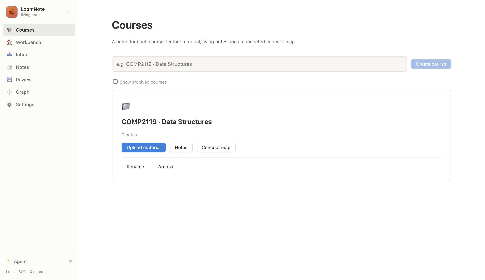 | 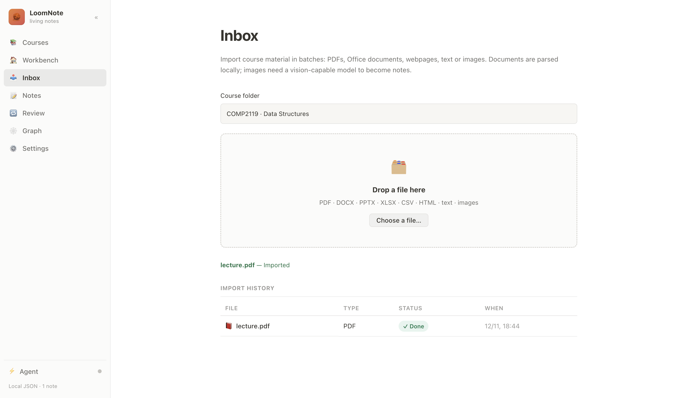 |

| Generated note | Agent request and streamed tool activity |
|---|---|
| 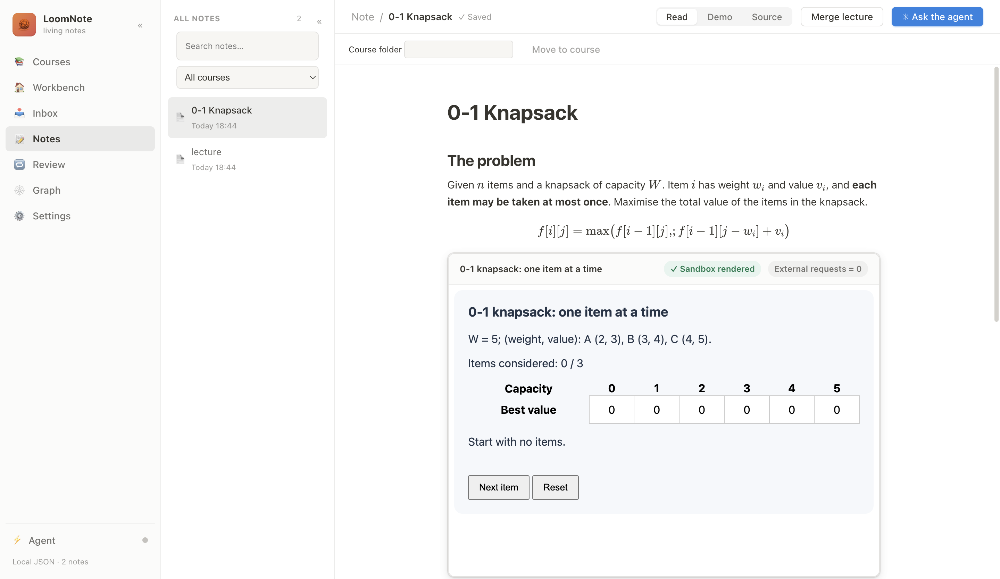 | 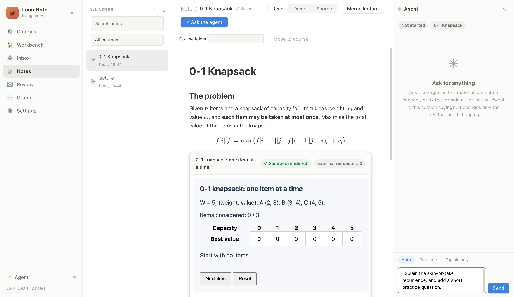 |

| Original source slides | Side-by-side source and note |
|---|---|
| 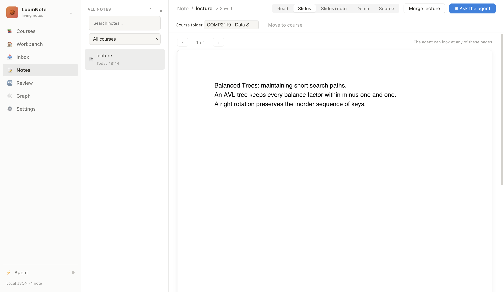 | 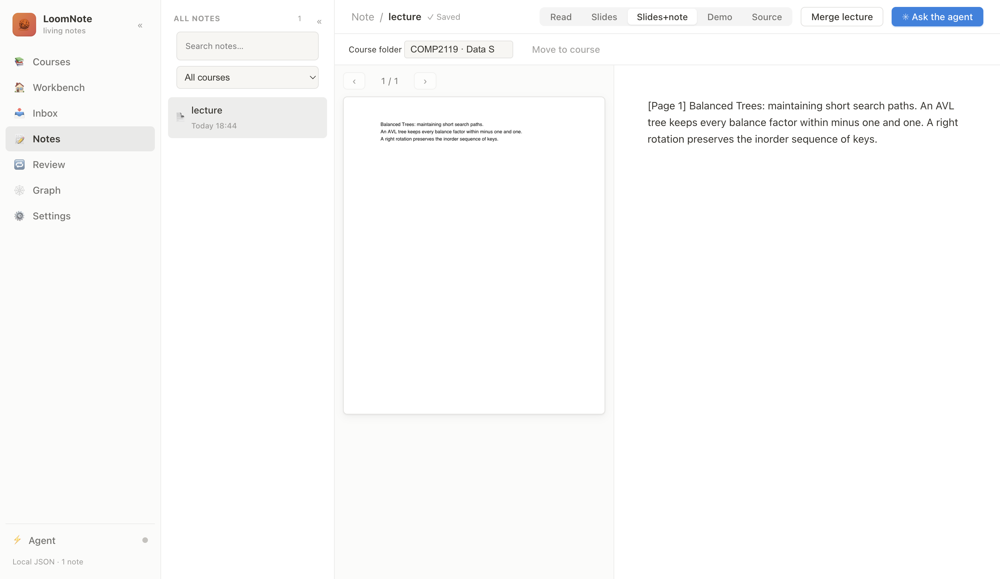 |

| Interactive explanation | Reviewable merge |
|---|---|
| 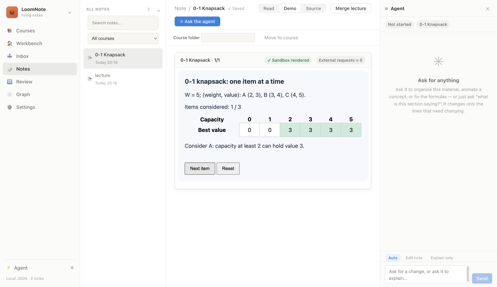 | 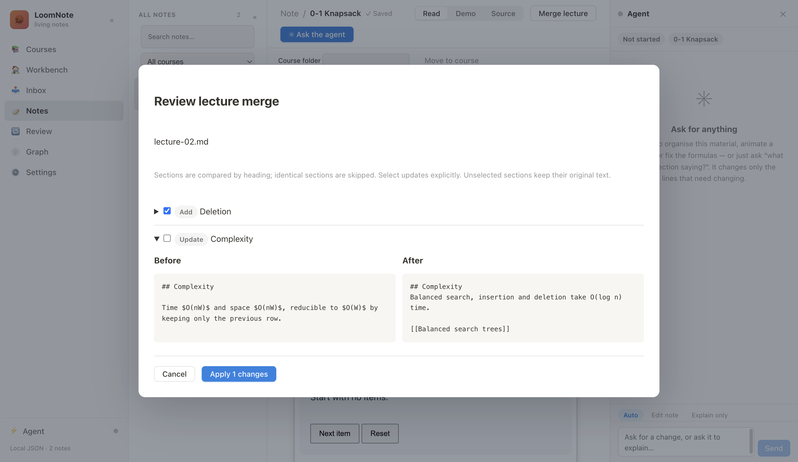 |

| Knowledge-point map | Review centre |
|---|---|
| 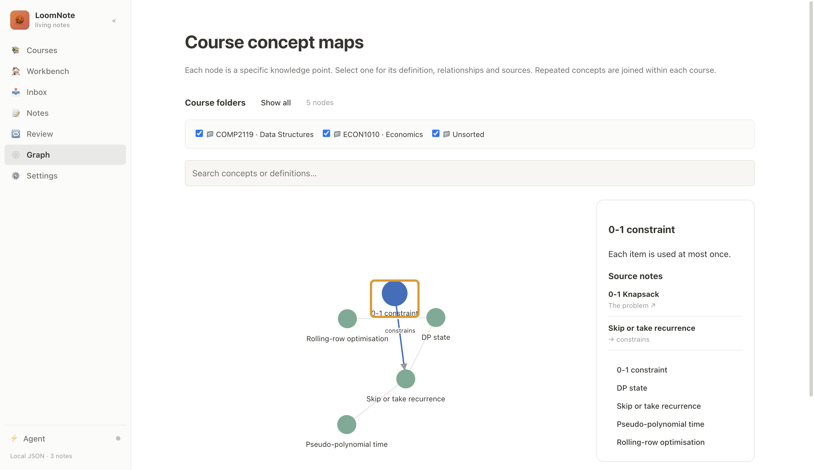 | 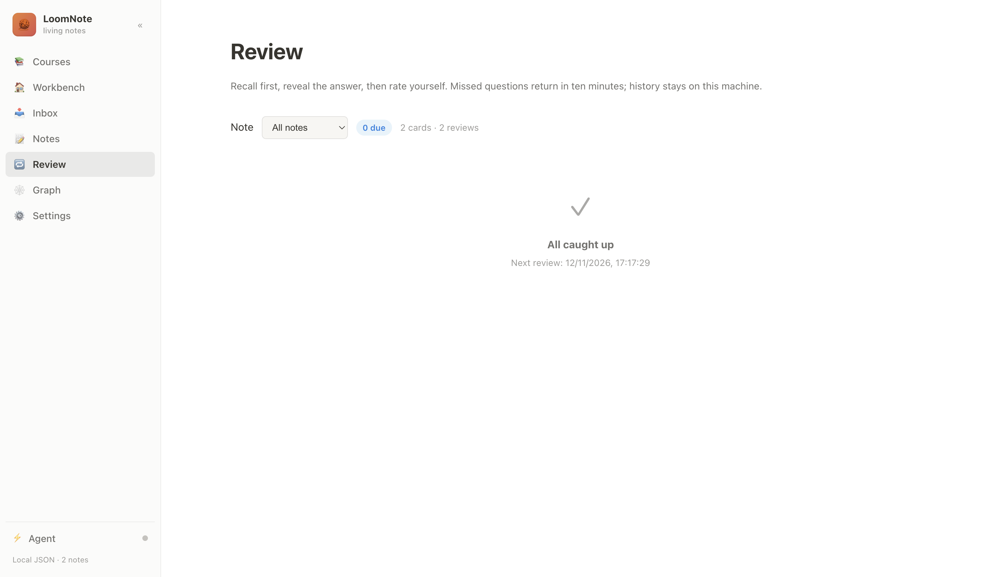 |

| Markdown source editor | Local settings and preferences |
|---|---|
| 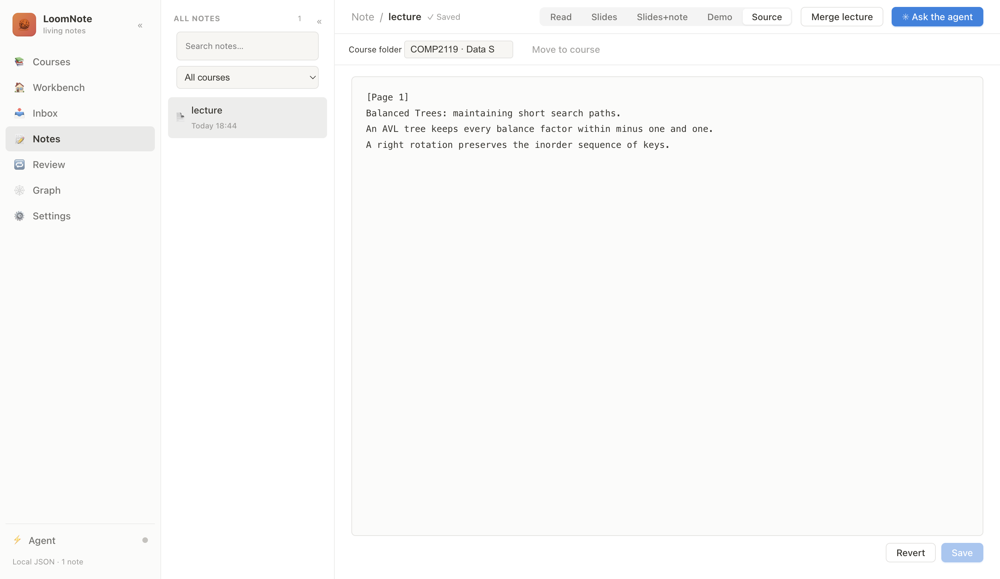 | 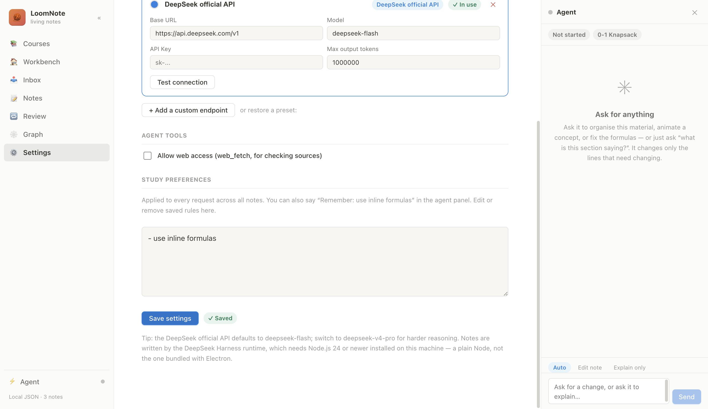 |

## Format boundaries

| Format | Local extraction and boundary |
|---|---|
| PDF | Text and PDF page indexes; original pages remain viewable. A scanned/textless PDF is refused because no OCR is bundled. |
| DOCX / PPTX | Paragraphs and table text / ordered slide text. Complex layout and embedded diagrams need checking against the original. |
| XLSX | Sheet/cell labels and cached values, including cached formula results. Formulas are not recalculated. |
| Markdown / TXT / CSV / TSV / JSON / TeX / LOG | UTF-8 text; structured formats are preserved as text for the agent. |
| HTML / HTM | Local text extraction; scripts/styles are not executed. |
| PNG / JPG / JPEG / WebP | Original image retained. Import does not perform OCR; interpretation requires a configured vision-capable model. |
| Legacy DOC / PPT / XLS | Explicit refusal; export to a modern Office format first. |

Imports are limited to 50 MB per file. Office archives also have expansion/entry/text limits; DTD/entity declarations are refused. These are document-to-text imports, not full Office rendering engines.

## Tests and recording

```bash
pnpm typecheck
pnpm test             # offline; never silently invokes a paid model
pnpm build
pnpm test:desktop     # actual built Electron workflow, including restart
pnpm test:live        # explicit real model test; uses your configured credentials
pnpm demo:record     # actual Electron + real model; saves local video/evidence
```

The repository includes the test suite, frozen lockfile and macOS/Windows CI. Tests generate small PDF, text and Office inputs in temporary directories. The desktop test automates the native picker result; extraction, persistence, views and review actions run in the real app. The recording is an automated demonstration and can make external model requests; it uses isolated app data and does not overwrite your study library. See [TESTING](docs/TESTING.md) and [DEMO](docs/DEMO.md).

## Local storage and model requests

Notes, sources, preferences, settings and review history are stored under Electron's user-data directory (`LOOMNOTE_DATA_DIR` can override it). The store uses SQLite when its native binding is available and JSON otherwise. `note.md` and its `source/` folder are ordinary local files; retain the whole folder when copying a note with images.

**When you ask the agent to work, the relevant material and your request are sent to the model endpoint you configured.** There is no LoomNote backend or account. Disabling web tools does not disable model requests. Use only materials you are entitled to process with that provider.

API keys are stored locally in settings and supplied to the child runtime through environment variables, rather than written into its profile overlay. The local settings store is **not encrypted**; protect the OS account and do not share its data folder, `config/local.env`, or raw runtime logs. Course originals, generated recordings and raw model logs stay outside the public repository.

## Implementation scope

LoomNote provides the course library, bounded document import, file-backed note workspace, source views, merge review, self-test scheduling, concept extraction/maps, provider settings, preference handling and sandboxed demo validation. The existing DeepSeek Harness runtime supplies the agent/tool execution; the configured model supplies generated explanations. Electron, PDF.js, KaTeX and Mermaid provide desktop, PDF, formula and diagram rendering. This application does not train a model or include a hosted graph or memory service.

The study workflow is customised around course ownership, lecture-page provenance, individual question answers and explicit knowledge-point relationships. The app preserves sources and makes model activity visible so a learner can inspect an explanation, practise it and return to its origin. Generated notes, relationships and demos can contain mistakes; the runtime checks are technical checks and do not establish academic correctness or learning gains.

## Repository and documentation

| Path | Responsibility |
|---|---|
| `packages/core` | Markdown IR, demo validation, review scheduling, merge diffing, concept extraction |
| `packages/memory` | Lightweight local memory primitives; no hosted memory dependency |
| `packages/harness` | Child process/SDK bridge, events, stream replay, agent profile |
| `apps/desktop` | Electron main/preload/renderer, document import, courses, study UI, persistence |
| `scripts` | Setup/start, live test and actual desktop recording driver; test inputs are generated in temporary directories |

- [Architecture](docs/ARCHITECTURE.md) — process boundaries, local data and sandbox design.
- [Workflow](docs/PIPELINE.md) — imports, generation, merging, review and maps.
- [Testing](docs/TESTING.md) and [demo recording](docs/DEMO.md).
- [Changelog](CHANGELOG.md).

## License

UNLICENSED — all rights reserved. This is a public source repository for a course/product project; see [LICENSE](LICENSE). Course/team planning material is kept outside the public tree.
