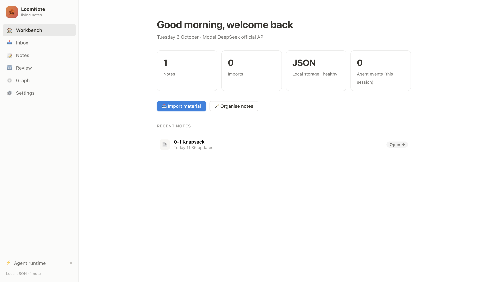
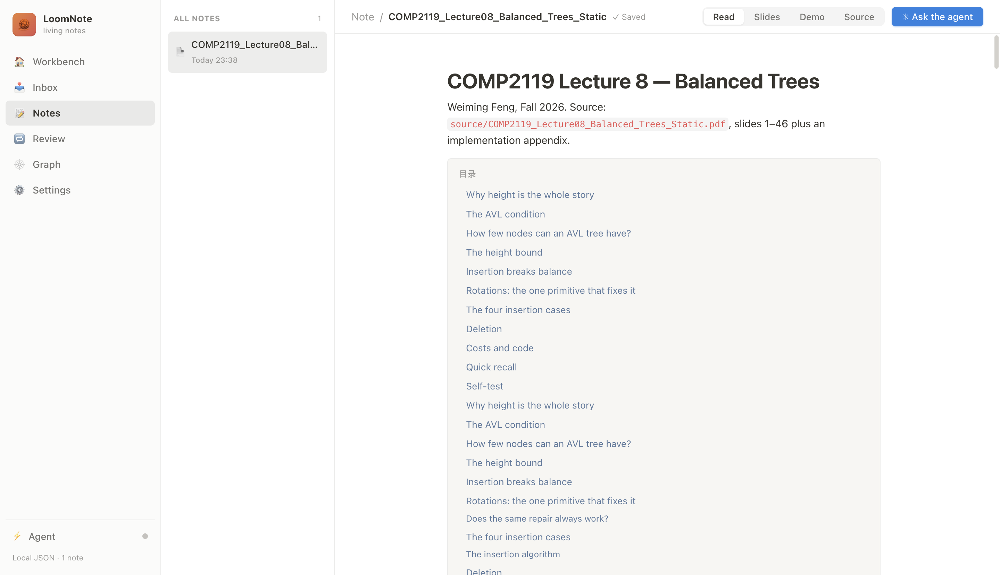
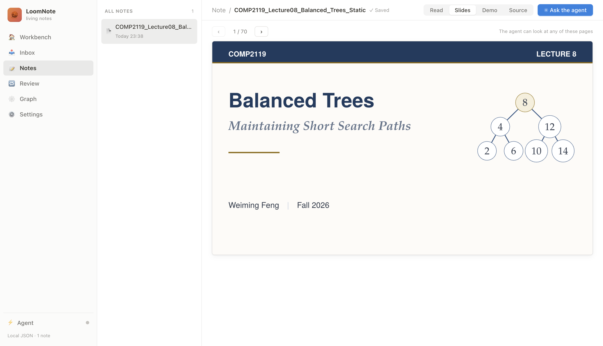
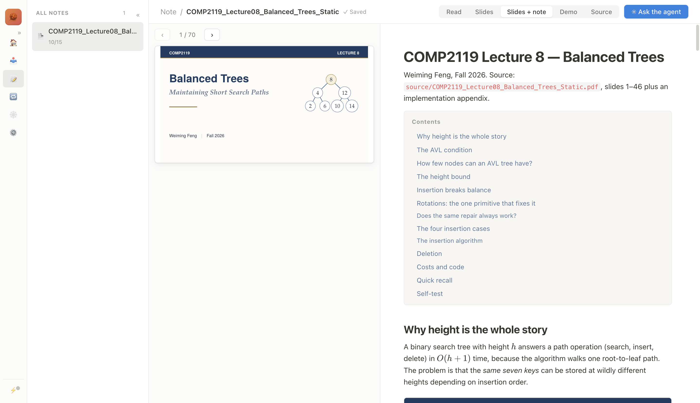
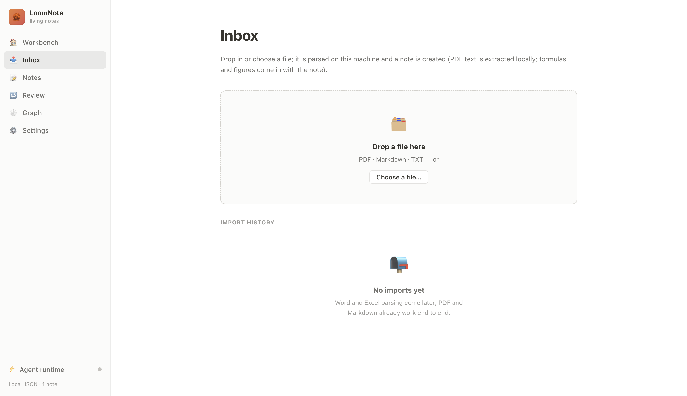
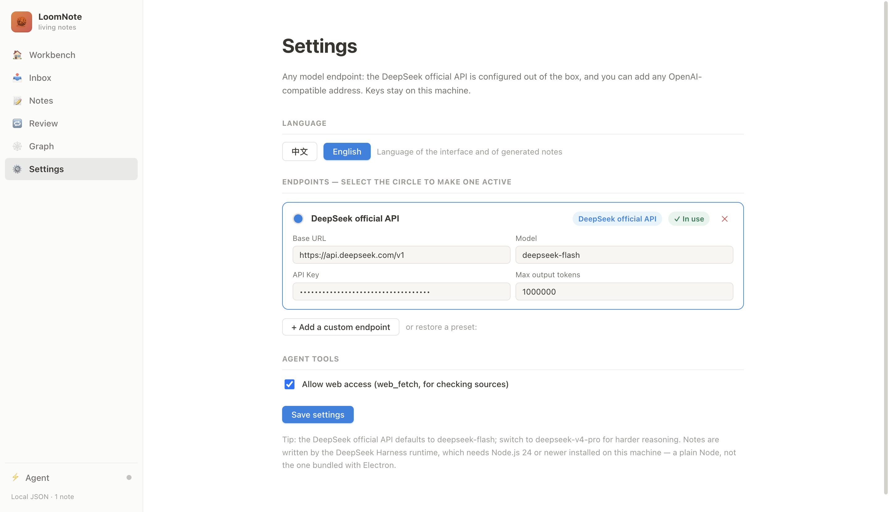

# LoomNote

[](https://github.com/PUFFERFISHTNT/loomnote/actions/workflows/ci.yml)

LoomNote is a local-first desktop study companion. A student drops in a lecture PDF and says in plain words what they want; an AI agent writes the study note while they watch — structured Markdown with KaTeX formulas, tables, self-test questions that cite the lecture page, and self-contained interactive HTML demos embedded wherever a concept is easier to see moving than to read. Everything runs on the student's own computer against a model key they bring themselves: no account, no server, and nothing uploaded.

## How it works

1. **Import a lecture.** Drag a PDF, Markdown or TXT file into the Inbox. The text is extracted locally (pdf.js); anything unsupported is refused with a clear message rather than silently mangled.
2. **The agent reads it.** The imported material becomes the context for the note, and the agent reads the note file itself before every change — never from memory.
3. **It plans.** The request becomes a turn on a DeepSeek Harness session: the agent reasons, decides which tools to call, and calls them one step at a time, in the open.
4. **It writes the note file.** Every note owns a working directory containing `note.md`. The agent edits that file with the runtime's own `read` / `write` / `edit` tools, so a small request is a small change — the product never rewrites a whole note to alter one line.
5. **It embeds a demo where movement teaches.** When a concept changes over time or over inputs — a queue draining, a recursion unwinding, a state machine stepping — the agent writes one self-contained interactive HTML block, and the note renders it inside a sandbox.
6. **It looks at the figures.** When a diagram carries the meaning, the agent opens that page image itself and places the figure in the note with a caption — rather than describing a picture it has not seen.
7. **It adds self-test questions that cite the lecture page.** Questions come with answers and explanations, and each answer points back at the material it came from, e.g. `(Lecture 3, p. 12)`.

## Built on the DeepSeek Harness runtime

LoomNote does not reimplement an agent loop. The agent layer is an integration with the **DeepSeek Harness** agent runtime (the npm packages `@deepseek-ai/dsh*`, pinned at `0.2.0-rc.2`), in `packages/harness`.

- **A supervised child process.** `@loomnote/harness` spawns the runtime as `dsh --profile sdk --patch <generated overlay>` and drives it over the runtime's published SDK JSON-RPC protocol on stdio — `initialize`, `session/prompt`, `shutdown`, plus the `session.event` and `session.status` notifications. The runtime's durable session log is translated into LoomNote's own event vocabulary (`HarnessEvent`), which is the only thing the rest of the app sees. Keeping the runtime out of the Electron main process means a harness failure is a restartable session, not a dead app.
- **A LoomNote-owned profile overlay.** `loomnote-study.patch.yml` is generated at runtime (`packages/harness/src/profile.ts`) and composed on top of the shipped `sdk` profile. It (a) sets the study-agent persona, (b) disables every tool a study-notes app has no use for — bash, pwsh, jobs, subagents, workflows, goals, skills, the plugin manager — leaving the file tools (`read` / `write` / `edit`), the search tools (`glob` / `grep`) and an opt-in web fetch, and (c) installs a permission preset, `loomnote-note-workspace` (sandbox `workspace-write`, approval `never`), so the agent can write inside the note's own folder and anything outside it is refused rather than turned into a prompt an SDK client cannot answer.
- **Thinking is shown as it happened.** The runtime publishes an assistant message when a step commits, not per token — but every committed message carries its original model stream: runs of reasoning, answer and tool-argument deltas, each with the millisecond gaps between them. LoomNote replays those gaps (`packages/harness/src/stream-replay.ts`) to reproduce the "watch it think" view. The replay is presentation only: the committed event always follows it, so a dropped replay can never change what the note contains.
- **The agent can ask the student to choose.** An SDK client has no wire method to answer the runtime's blocking ask-user tool, so LoomNote asks in band: the agent ends a reply with a fenced `loomnote:ask` block holding a question and 2–5 options, the app renders them as clickable cards, and a click becomes the next user message (`packages/harness/src/ask.ts`).
- **The agent sees the slides.** A PDF import is copied into the note's own folder as `source/<name>.pdf`, and the renderer rasterises one PNG per page into `source/pages/`. `read_image` (from the runtime's own filesystem tool) is left enabled in the profile precisely so the agent can open a page, look at the diagram, and embed it — instead of guessing from extracted text.
- **A real Node.js runtime is required.** The harness loads native add-ons whose loader supports plain Node only; under Electron-as-node it refuses to start. The app therefore locates a system Node at startup (`packages/harness/src/node-runtime.ts`), honouring the `LOOMNOTE_NODE` environment variable, and fails with an actionable message when it cannot find one.

## Features

- **Smart import** — drag PDF / Markdown / TXT into the Inbox; text is extracted locally (pdf.js). Unsupported types are rejected with a clear message, never silently corrupted.
- **A harness agent, not a home-grown loop** — planning, tool calls and revisions all run on the DeepSeek Harness runtime, under a LoomNote profile that trims the toolbelt down to what a note needs.
- **Thinking, streamed** — the runtime panel shows reasoning and answer text replayed at the pace the model produced it, alongside every tool call and its result. Stop at any point and ask for something else.
- **The note is a real file** — `note.md` in the note's own folder, edited in place with the runtime's file tools and watched by the app, so the preview follows the file rather than the other way round.
- **See the deck, not our extraction of it** — an imported PDF opens as the PDF: the *Slides* view renders it page by page, the *Slides + note* view puts the deck beside the note written from it, and both sit next to the read/edit tabs.
- **The agent reads the slides itself** — every PDF page is rasterised once into the note's own folder, and the agent reads the pages it needs with `read_image`, then embeds a figure with a caption where a diagram says it better than prose (`` — a relative path, so the note stays portable).
- **Mixed md + HTML notes** — Markdown as the single source of truth; `:::demo` slots carry sandboxed interactive HTML demos (CSP + sandboxed iframe, zero external requests). The sandbox bridge can also list a demo's controls and press one, which is how "the demo still plays" is checked without a human.
- **Room to work** — the navigation rail, the note list and the agent panel each fold away on their own, and the preferences survive a restart.
- **Self-test questions** — the agent generates questions with answers and explanations inline, each citing where it came from.
- **The agent asks instead of guessing** — an ambiguous request comes back as 2–5 clickable options, and the click continues the conversation.
- **Local-first + BYOK** — all data stays in a local SQLite store; bring your own LLM key (any OpenAI-compatible endpoint). No cloud account, no server.
- **DeepSeek official out of the box** — ships configured for `deepseek-flash` with a 1M-token output budget; any other OpenAI-compatible endpoint (including a model running on the same machine) can be added in Settings.
- **English and Chinese** — English is the default; one click in Settings switches both the interface language and the language the agent writes notes in.

## Screenshots

| Workbench | Note with an embedded demo (sandboxed, zero external requests) |
|---|---|
|  |  |

| The original deck | Deck and note, side by side |
|---|---|
|  |  |

| Inbox | Settings · language, endpoint and agent tools |
|---|---|
|  |  |

## Requirements

- **Node.js 24 or newer — a plain Node, not Electron's.** The harness runtime's native add-ons refuse to load under the Node that Electron ships, so the app looks for a system Node at startup. Set `LOOMNOTE_NODE` to point it at a specific executable.
- **pnpm 10** (`packageManager: pnpm@10.34.5`).
- **macOS or Windows.** The setup scripts cover both. macOS is verified end to end; the Windows paths are written but have not been run on hardware.
- A model credential for the DeepSeek official API, or any OpenAI-compatible endpoint, entered in Settings.

## Quick start

```bash
# one-command setup: checks the toolchain, installs deps, builds
./scripts/setup.sh          # macOS / Linux
.\scripts\setup.ps1         # Windows PowerShell

# or manually
pnpm install
pnpm typecheck              # TS strict across every package
pnpm build
./scripts/start.sh          # launch the app
.\scripts\start.ps1         # launch the app on Windows
```

`start.sh` / `start.ps1` load `config/local.env` when it exists, build the app on first run, and then launch Electron from a real terminal — which is also what keeps a host-injected `ELECTRON_RUN_AS_NODE` out of the app's environment. Use `pnpm dev` for the hot-reloading development build.

## A worked example: input, and what to expect

Reproducing the core path is a five-minute job on macOS.

**Input** — one lecture PDF, `COMP2119 Lecture 08 — Balanced Trees` (70 slides), and this request typed into the agent panel:

> Turn this lecture into an English study note. Where a diagram carries the meaning, look at that slide yourself and place the figure in the note with a caption. Animate how a rotation rebalances the tree, and end with five self-test questions that cite the slide page.

**What you should see**, in order:

1. The deck appears as the deck — *Slides* view, page 1 of 70 — within a few seconds of import.
2. Your sentence is echoed in the agent panel, and below it a **Thinking** block that grows as the model works.
3. Tool lines appear and complete: a run of `read_image` calls (the agent looking at individual slides), then `write` once, then `edit` for every later change.
4. The note fills in on the left while it is being written; the header reads *Writing to the file…* and then *Saved*.
5. Switch to **Slides+note**: the deck on the left, the note on the right. Walk the deck to a rotation slide and the note beside it describes the same rotation, with the figure drawn from that slide.
6. Switch to **Read** and scroll: headings, KaTeX maths, figures with captions that end in `(p. 12)`, an interactive rotation demo, and five self-test questions whose answers cite their slide.
7. Ask a follow-up (*"make the demo start from an unbalanced tree"*). The agent answers in chat and changes only the lines that needed it — it does not rewrite the note.

**Where the result lives.** A note is a real file, not a database row: `<userData>/workspaces/<noteId>/note.md` next to `source/<deck>.pdf` and one PNG per slide in `source/pages/`. Open `note.md` in any editor to check what the agent actually wrote.

**How to check it without a model.** Most of the app can be exercised with no model running: import a PDF and the *Slides* view works on its own; the note folder is plain files you can read; `pnpm typecheck` checks every package. The parts that need a model are the writing itself.

A demo is a program the model wrote, so the app runs it in a locked-down frame before the note is allowed to keep it, and hands a failure back to the agent with the measurement rather than showing you a dead box. What a working one looks like is in [docs/PIPELINE.md](docs/PIPELINE.md); the suite's runs and the live run are recorded in [docs/EVIDENCE.md](docs/EVIDENCE.md).

## Configure a model

DeepSeek's official API is the preset, already pointed at `deepseek-flash` with a long output budget. Open **Settings**, paste your own API key and save: the key is held in the app's local store and is never written to disk in a form that leaves the machine. Additional OpenAI-compatible endpoints can be added there too; each one becomes a route in the generated profile overlay, and its key travels in the child process environment rather than in the overlay file.

## Repository layout

```
packages/core/      IR parsing · demo HTML discipline validator · query feature analysis
packages/memory/    memory engine (chunker / dedup / recall / folding / rules)
packages/harness/   DeepSeek Harness bridge: process supervision, SDK JSON-RPC session,
                    event normalisation, stream replay, profile overlay, ask blocks
apps/desktop/       Electron app (main / preload / renderer · demo sandbox · note workspace)
docs/               architecture, pipeline, testing and platform notes (English)
```

## Documentation

- [docs/ARCHITECTURE.md](docs/ARCHITECTURE.md) — process and package boundaries, the profile overlay, the event flow, where local data lives, the security posture.
- [docs/PIPELINE.md](docs/PIPELINE.md) — the end-to-end workflow, step by step, and the demo-discipline rules.
- [docs/EVIDENCE.md](docs/EVIDENCE.md) — what was run, when, and what came back: the suite's results, the live run, and the known limitations.
- [docs/SETUP-WINDOWS.md](docs/SETUP-WINDOWS.md) — Windows-specific setup notes.
- [CHANGELOG.md](CHANGELOG.md) — what changed between versions.

Internal planning and review documents are kept outside this repository; the public tree ships English documentation only.

## Your material, your responsibility

Everything runs locally: imported files are read and stored on your own machine, nothing is uploaded to us, and nothing is redistributed.

Two rules:

1. Import material you are allowed to use.
2. If you import anything you are not entitled to, the responsibility is yours, not the tool's.

## License

UNLICENSED — all rights reserved. This is a private course/product project; licensing to be decided before any public release. See [LICENSE](LICENSE).

## Course

Built as the team project for **AILT9019 · AI Literacy II** (HKU, Fall 2026). The course proposal is a course deliverable and is kept out of this repository.
